<div align="center">

# 🩻 MedVision
### Vision Transformer × Retrieval-Augmented Generation × Gemini

**An end-to-end research prototype for chest X-ray finding classification and source-grounded educational explanations.**

[](https://www.python.org/)
[](https://pytorch.org/)
[](https://huggingface.co/)
[](https://github.com/facebookresearch/faiss)
[](https://fastapi.tiangolo.com/)
[](https://streamlit.io/)
[](#limitations-and-responsible-use)

[Overview](#overview) · [Demo](#application-walkthrough) · [Architecture](#system-architecture) · [Evaluation](#model-and-evaluation) · [RAG](#retrieval-augmented-generation) · [Run Locally](#local-setup) · [Roadmap](#roadmap)

</div>

> [!IMPORTANT]
> **Educational and research use only.** MedVision is **not clinically validated**, is **not a medical device**, and must not be used to diagnose patients or guide treatment. Model scores are **uncalibrated outputs**, not confirmed abnormalities or calibrated disease probabilities.

## At a glance

| Metric | Value | Interpretation |
|:--|--:|:--|
| Original NIH ChestX-ray14 dataset | **112,120** images | Size of source dataset; **not** the number trained on |
| Images used in training | **~77,856** | Recorded training stream, approximately 9,732 batches × batch size 8 |
| Validation images | **8,668** | Validation subset reported by training notebook |
| Test images | **25,596** | Held-out test evaluation count reported by notebook |
| Radiographic labels | **14** | Multi-label outputs; an image can have multiple findings |
| Validation mean AUROC | **0.7781** | Mean area under the ROC curve across labels |
| Test mean AUROC | **0.7535** | Mean area under the ROC curve across labels |
| RAG knowledge base | **8 documents / 19 chunks** | Local medical reference text embedded for retrieval |

**AUROC is not classification accuracy.** Counts describe the reported training/evaluation runs; do not assume these splits are patient-disjoint without checking the notebook's split logic.

## Overview

MedVision connects **computer vision** and **retrieval-augmented generation (RAG)** in one application:

1. A user uploads a chest X-ray in the **Streamlit** interface.
2. A fine-tuned **Vision Transformer (ViT)** generates scores for **14 radiographic finding labels**.
3. The highest-ranked findings become a query for **Sentence Transformers + FAISS** retrieval.
4. Retrieved medical reference excerpts are supplied to **Gemini**, which generates an **educational, source-grounded explanation**.
5. The interface presents the image, scores, charts, a detailed table, explanations, and source filenames.

This design separates **visual classification** from **textual explanation**. The language model is not directly interpreting X-ray pixels; it explains model-ranked labels using retrieved reference material.

## Application walkthrough

### 1. Application dashboard

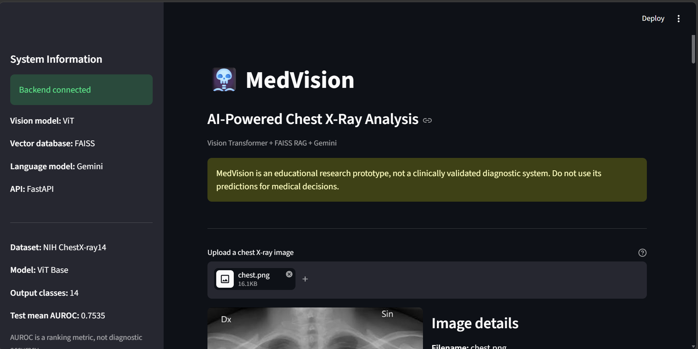

The sidebar shows backend connectivity, model family, vector store, language model, API framework, and the reported test mean AUROC.

### 2. Upload and inspect a chest X-ray

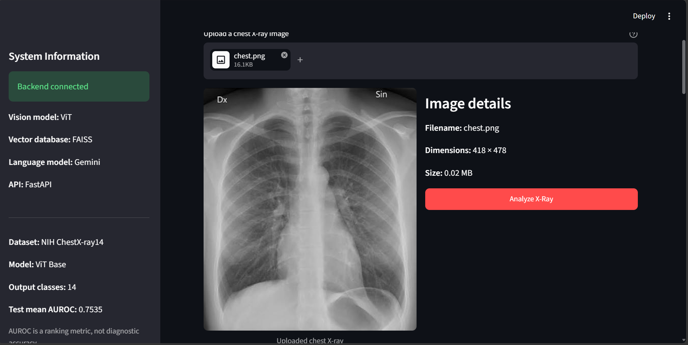

The interface previews the uploaded image, shows basic file metadata, and provides an **Analyze X-Ray** action.

### 3. Review the top-ranked findings

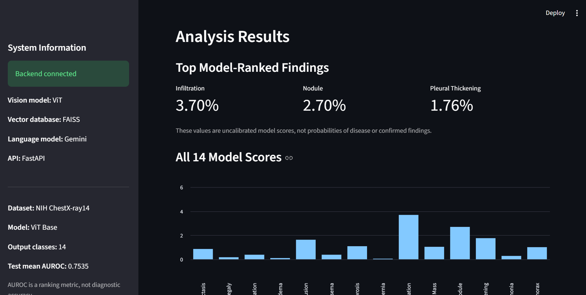

The example screenshot shows **Infiltration (3.70%)**, **Nodule (2.70%)**, and **Pleural Thickening (1.76%)** as the highest-ranked outputs for that particular image. **These are uncalibrated model scores, not probabilities of disease.**

<details>
<summary><strong>See the complete 14-label score chart</strong></summary>

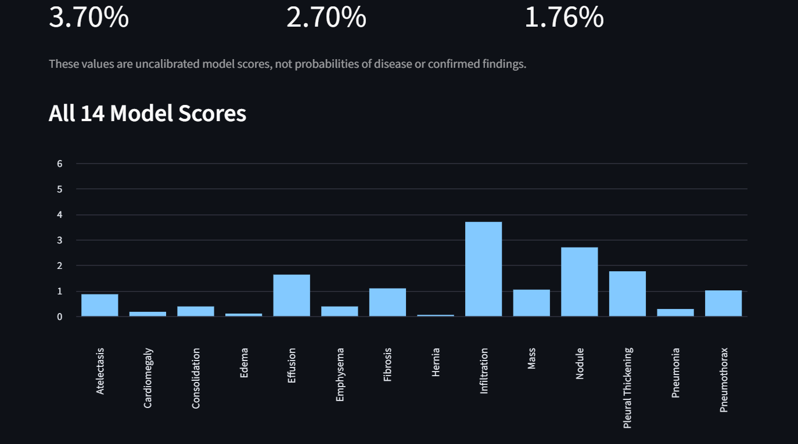

</details>

<details>
<summary><strong>See the detailed prediction table</strong></summary>

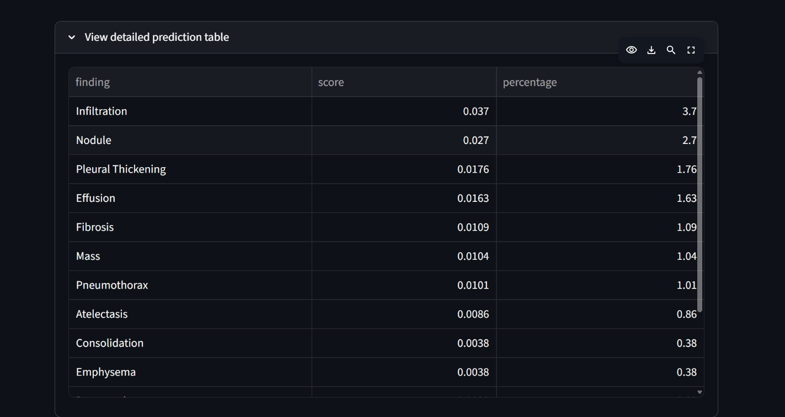

</details>

### 4. Read grounded educational explanations

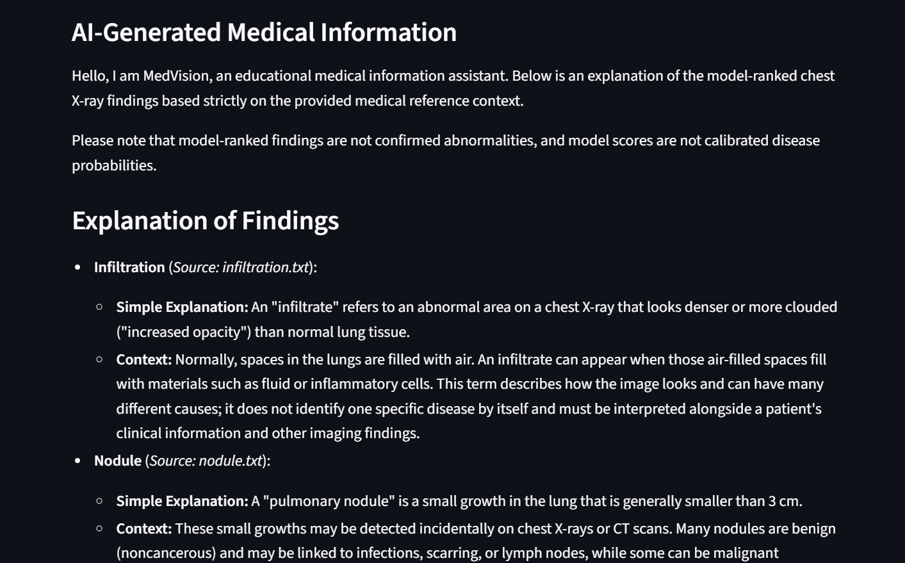

The explanation identifies the retrieved medical document supporting each discussion, and explicitly avoids presenting model-ranked labels as confirmed diagnoses.

<details>
<summary><strong>See retrieved source filenames and safety notice</strong></summary>

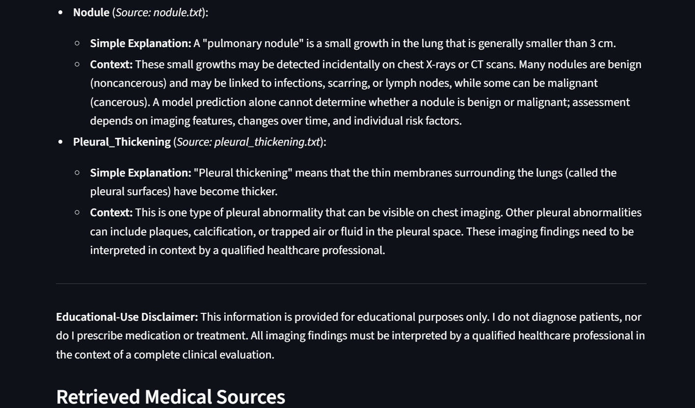

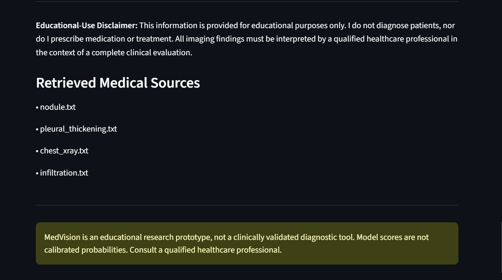

</details>

## System architecture

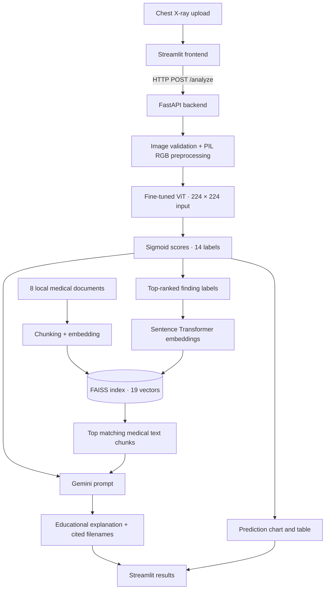

### Component responsibilities

| Layer | Implementation | Role |
|---|---|---|
| Vision | PyTorch, Hugging Face ViT | Multi-label image classification |
| Preprocessing | Pillow, ViT image processor | Decode and prepare input image |
| Embeddings | `all-MiniLM-L6-v2` | Encode text queries and reference chunks |
| Vector search | FAISS `IndexFlatIP` | Similarity search over normalized embeddings |
| Explanation | Gemini API | Generate educational text from retrieved context |
| API | FastAPI, Uvicorn | Image upload, inference, retrieval, JSON response |
| UI | Streamlit | Uploads, visualizations, explanations, source display |

## Dataset and labels

**Source:** [NIH ChestX-ray14](https://nihcc.app.box.com/v/ChestXray-NIHCC), accessed in the training workflow through `timm/nih-chest-xray-14` on Hugging Face.

The dataset provides frontal chest radiographs with labels derived from associated reports. It is **multi-label** and may have class imbalance or imperfect labels. The dataset's **112,120** images should not be conflated with the number of examples actually used in the recorded training run.

<details>
<summary><strong>Show all 14 output labels</strong></summary>

| | | |
|---|---|---|
| Atelectasis | Cardiomegaly | Consolidation |
| Edema | Effusion | Emphysema |
| Fibrosis | Hernia | Infiltration |
| Mass | Nodule | Pleural Thickening |
| Pneumonia | Pneumothorax | |

`No Finding` is not an additional output head in this 14-label model.

</details>

### Reported image counts

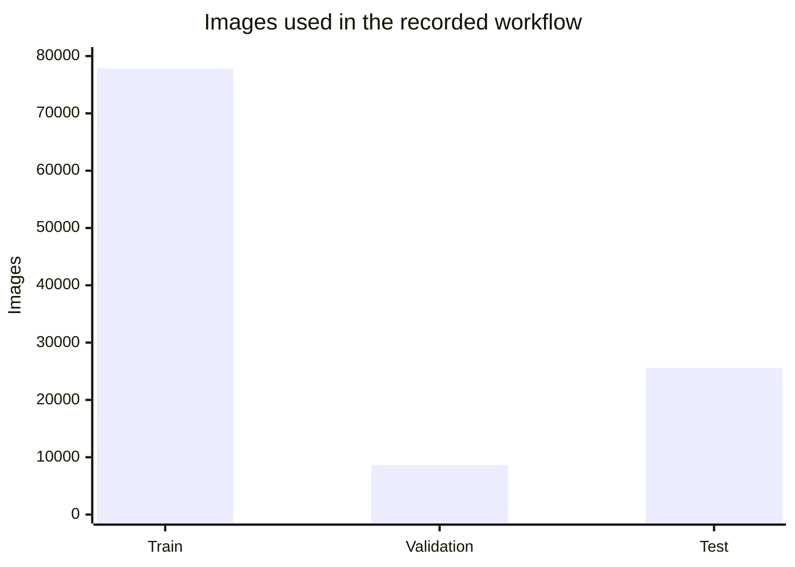

**Note:** The training count is reconstructed from recorded batches and batch size; it is not a claim that every source image was trained on. The original dataset total and these reported split counts should not be treated as a verified exhaustive partition of unique patients.

## Model and evaluation

| Setting | Details |
|---|---|
| Base checkpoint | `google/vit-base-patch16-224-in21k` |
| Architecture | Vision Transformer (ViT-Base) |
| Input size | 224 × 224 pixels |
| Task | 14-label multi-label classification |
| Loss | Binary cross-entropy with logits (`BCEWithLogitsLoss`) |
| Output transformation | Sigmoid per label |
| Model artifact | `backend/model/best_model.pth` (not committed) |
| Reported best checkpoint | Epoch 2 |

### Mean AUROC

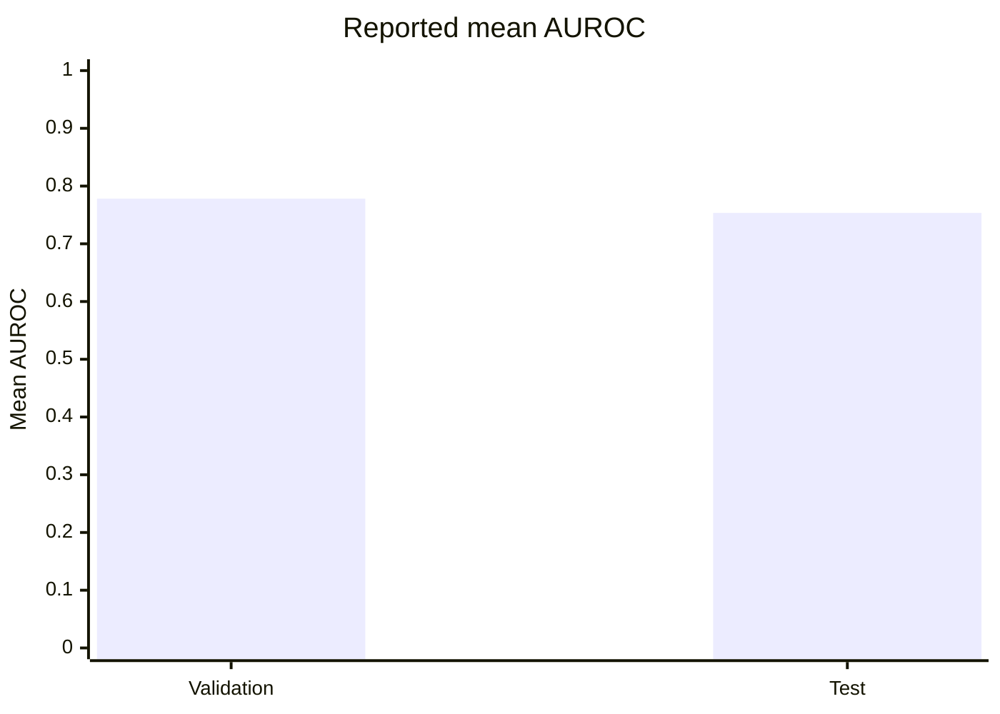

| Evaluation split | Mean AUROC |
|---|---:|
| Validation | **0.7781** |
| Test | **0.7535** |

The charts show **dataset-level evaluation metrics**. They do not measure the accuracy of the example X-ray displayed in the screenshots. No clinical diagnostic performance, calibrated probability estimates, or external validation are claimed.

## Retrieval-Augmented Generation

The knowledge pipeline is built by `backend/build_rag.py`:

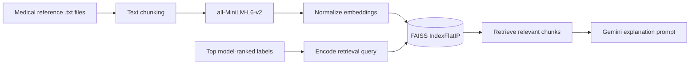

| RAG configuration | Current implementation |
|---|---|
| Reference documents | 8 `.txt` files |
| Indexed chunks | 19 |
| Embedding model | `sentence-transformers/all-MiniLM-L6-v2` |
| Embedding size | 384 dimensions |
| Index | FAISS `IndexFlatIP` with normalized vectors |
| Chunking | Approximately 350 words, 50-word overlap |
| Retrieved context | Top 5 chunks per request |
| Grounding | Retrieved text plus source filenames supplied to Gemini |

Reference materials include MedlinePlus-derived content and supplementary summaries. These documents are **not** the chest X-ray training dataset. Retrieved text can improve traceability but does **not** guarantee factual correctness or medical safety of generated responses.

## API reference

FastAPI serves an HTTP API locally at `http://127.0.0.1:8000`.

| Method | Endpoint | Purpose |
|---|---|---|
| `GET` | `/` | Basic API information |
| `GET` | `/health` | Report model, FAISS, and document availability |
| `POST` | `/analyze` | Accept an X-ray image and return scores, retrieved sources, and explanation |

<details>
<summary><strong>Example API request</strong></summary>

```bash
curl -X POST "http://127.0.0.1:8000/analyze" \
  -F "file=@chest.png"
```

The endpoint accepts PNG/JPEG uploads (up to 10 MB in the current implementation). The response includes `status`, `filename`, `predictions`, `top_findings`, `explanation`, `sources`, and `disclaimer`.

</details>

## Repository layout

```text
MedVision/
├── backend/
│   ├── main.py                  # FastAPI + ViT inference + retrieval + Gemini
│   ├── build_rag.py             # Generate embeddings and FAISS index
│   ├── documents/               # Medical reference text
│   ├── model/
│   │   └── best_model.pth       # Local checkpoint; NOT tracked by Git
│   └── rag/
│       ├── medical.index       # Generated locally; NOT tracked
│       └── chunks_metadata.pkl # Generated locally; NOT tracked
├── frontend/
│   └── app.py                   # Streamlit user interface
├── assets/                      # README screenshots
├── .env                         # Local API key; NOT tracked
├── .gitignore
├── requirements.txt             # Planned dependency manifest
└── README.md
```

## Local setup

> [!NOTE]
> **Current reproducibility limitation:** The trained ViT checkpoint is not publicly distributed in this repository. Without a compatible `best_model.pth`, the backend cannot run inference. `requirements.txt` is also being prepared; until it is committed, install the dependencies listed below manually.

### 1. Clone and create an environment

```powershell
git clone https://github.com/SID-crypt/MedVision.git
cd MedVision
py -m venv venv
.\venv\Scripts\Activate.ps1
```

### 2. Install Python packages

Once `requirements.txt` is committed:

```powershell
pip install -r requirements.txt
```

Current key dependencies: `torch`, `transformers`, `sentence-transformers`, `faiss-cpu`, `fastapi`, `uvicorn`, `python-multipart`, `google-genai`, `python-dotenv`, `streamlit`, `pillow`, `numpy`, `pandas`, `requests`, and `beautifulsoup4`.

### 3. Set the Gemini API key

Create a local `.env` file in the repository root:

```dotenv
GEMINI_API_KEY=your_api_key_here
```

**Never commit API keys or the `.env` file.**

### 4. Supply the fine-tuned checkpoint

Place the trained model file at:

```text
backend/model/best_model.pth
```

The repository currently does **not** provide a public checkpoint download or training-reproduction script.

### 5. Generate the RAG index

```powershell
python backend/build_rag.py
```

This creates local FAISS and metadata artifacts from the reference documents.

### 6. Run the API

```powershell
python -m uvicorn backend.main:app --host 127.0.0.1 --port 8000
```

- Interactive API docs: http://127.0.0.1:8000/docs
- Health endpoint: http://127.0.0.1:8000/health

### 7. Run the UI in a second terminal

```powershell
python -m streamlit run frontend/app.py
```

Open http://localhost:8501. Initial model loading can take time on CPU-only machines.

## Limitations and responsible use

- **Not clinically validated.** Results must not be used to diagnose, triage, or treat patients.
- **Scores are uncalibrated.** Sigmoid outputs are not reliable individual disease probabilities.
- **Label quality and imbalance.** Dataset labels can be noisy and some findings are rare.
- **Generalization unknown.** External hospitals, devices, and populations may perform differently.
- **Potential data leakage must be audited.** Patient-level separation has not been established by this README.
- **RAG is not a medical safety guarantee.** Generated text may still be inaccurate or incomplete.
- **Checkpoint not distributed.** Full end-to-end reproduction currently requires the local trained model file.
- **Privacy.** Use only appropriately licensed, de-identified images for demonstrations; do not upload patient data without authorization and suitable safeguards.

## Roadmap

- [x] Fine-tuned ViT inference for 14 radiographic labels
- [x] FAISS retrieval over medical reference documents
- [x] Gemini educational explanation generation
- [x] FastAPI inference endpoint
- [x] Streamlit image upload, charts, and source display
- [ ] Publish a reproducible dependency lockfile and model acquisition instructions
- [ ] Document training hyperparameters and patient-wise split checks
- [ ] Add per-class AUROC, confidence intervals, and threshold/calibration evaluation
- [ ] Add RAG retrieval and answer-grounding evaluation
- [ ] Add automated tests and CI
- [ ] Containerize and document deployment
- [ ] Evaluate workflow orchestration and observability

## Acknowledgments

- **NIH ChestX-ray14** — chest radiograph research dataset
- **Hugging Face Transformers / PyTorch** — vision model tooling
- **Sentence Transformers / FAISS** — semantic retrieval
- **MedlinePlus** — medical reference material
- **Google Gemini** — language-model explanations

---

<div align="center">

**MedVision · Computer Vision + RAG + Generative AI**

[Back to top](#-medvision) · [Repository](https://github.com/SID-crypt/MedVision)

</div>
